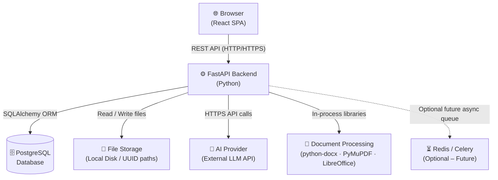
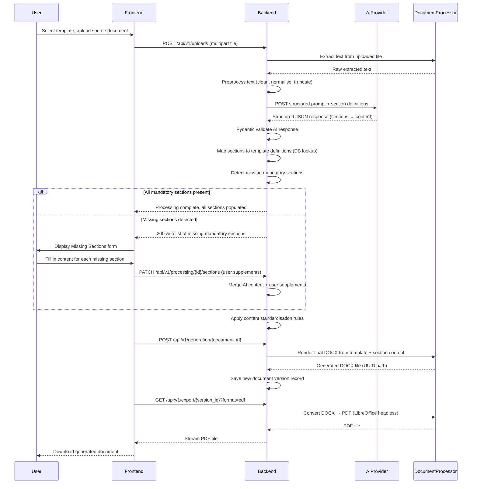

# DocuForge AI – Architecture

---

## 1. System Architecture Overview

DocuForge AI is built as a **monolithic, layered system** composed of four primary layers: a single-page React frontend, a FastAPI backend API, a PostgreSQL database, and an external AI provider. All communication between the frontend and backend occurs via a versioned REST API over HTTP/HTTPS. Document processing is handled entirely within the backend process using dedicated Python libraries, with an optional LibreOffice headless sidecar for PDF export.

| Layer | Responsibility |
|---|---|
| **React SPA** | All user interface, interaction, form input, document preview, and routing |
| **FastAPI Backend** | REST API, authentication, business logic, AI orchestration, file management, document generation |
| **PostgreSQL** | Persistent storage of all application data, templates, documents, users, audit logs |
| **AI Provider (External)** | Accepts preprocessed document text and returns structured JSON content mappings |
| **Document Processing** | Text extraction from uploaded files; DOCX/PDF/Markdown generation and export |
| **File Storage (Local)** | UUID-keyed directories for uploads, generated documents, and templates |



---

## 2. Component Responsibilities

### 2.1 Frontend (React SPA)

The frontend is a fully client-rendered single-page application built with **React 18 + TypeScript**, bundled by **Vite**, and styled with **Tailwind CSS** and **shadcn/ui** component primitives.

- **User Interface and Interaction** – Renders all screens, responds to user events, and drives all workflows from document creation through final export.
- **Form Validation** – Client-side validation using controlled components and schema-based validators before any API call is made.
- **Document Preview Rendering** – Displays AI-generated and user-supplemented document content in a structured, section-by-section preview prior to final generation.
- **In-Browser Document Editing** – Allows users to review and edit individual section content produced by AI before committing to generation.
- **API Communication via Axios** – All backend interaction is performed through a typed Axios service layer with request/response interceptors for auth token management.
- **State Management** – Auth state via React Context; server-fetched data managed via React Query (or Zustand) with caching and invalidation.
- **Routing** – Client-side routing via React Router, with protected routes enforcing authentication and role requirements.

---

### 2.2 Backend (FastAPI)

The backend is a **Python FastAPI** application running under **uvicorn**, structured as a set of modular routers sharing a common core. It is the single point of truth for all business logic.

- **REST API Endpoints** – Versioned API endpoints under `/api/v1/`, grouped by domain (auth, users, templates, documents, processing, generation, export).
- **Authentication and Authorisation** – Issues and validates JWT access and refresh tokens; enforces role-based access control on all protected routes via FastAPI dependency injection.
- **Request Validation with Pydantic** – Every incoming request body, query parameter, and path parameter is validated and deserialised using Pydantic schemas before reaching business logic.
- **Business Logic Enforcement** – Document lifecycle rules, template selection, mandatory section policies, and generation constraints are all enforced here.
- **Template and Document Management** – Full CRUD for templates and documents including version tracking, status transitions, and ownership management.
- **Orchestrating the AI Pipeline** – Coordinates content extraction → preprocessing → AI submission → response validation → section mapping → missing section detection.
- **File Upload Handling** – Accepts file uploads, validates MIME types and file sizes, stores files under UUID-keyed paths, and records metadata in the database.
- **Document Generation** – Triggers the appropriate generator (DOCX, PDF, Markdown) and writes output files, creating a new version record.
- **Audit Logging** – Appends immutable records to the audit log for all significant events (login, document create/generate/export/delete, AI call).

---

### 2.3 AI Processing Layer

The AI processing layer acts as a **narrow, well-defined bridge** between raw document text and structured content that can populate a template. The AI is responsible only for content extraction and organisation — never for inventing information.

- **Document Content Submission** – Preprocessed plain text extracted from an uploaded file, together with the template's section definitions, is submitted to the external LLM API.
- **Structured JSON Response Parsing** – The LLM is prompted to return a strict JSON object matching a predefined Pydantic schema. Only structured JSON output mode is used.
- **Pydantic Validation of AI Responses** – The raw JSON response from the LLM is immediately validated and sanitised through a Pydantic model. Responses that do not conform are rejected or flagged.
- **Section Mapping Logic (Python, not AI)** – Deterministic Python code maps the AI-returned field values to the corresponding template section records stored in the database.
- **Missing Section Detection (Python, not AI)** – Python code, using the database's mandatory/optional section definitions for the template, identifies which mandatory sections the AI was unable to populate from the document text.
- **AI Never Fabricates Missing Information** – The AI is explicitly instructed to return `null` or an empty value for any section whose content is not present in the source document. Fabrication is treated as a validation error.
- **Uploaded Document Treated as Data, Not Instructions** – The uploaded file content is embedded in the user message portion of the prompt, clearly separated from the system prompt, preventing prompt injection.

---

### 2.4 Document Processing

The document processing layer handles both **ingestion** (extracting text from uploaded files) and **generation** (producing standardised output documents).

- **Text Extraction from DOCX** – `python-docx` reads paragraphs, runs, tables, and headings from uploaded DOCX files, preserving structural information where useful.
- **Text Extraction from PDF** – `PyMuPDF` (fitz) extracts text page-by-page from uploaded PDFs, with page boundary awareness.
- **Text Extraction from Markdown** – The `markdown` library parses Markdown source and strips markup to produce clean plain text for AI submission.
- **Text Extraction from TXT** – Plain text files are read with encoding detection and minimal cleanup.
- **DOCX Document Generation** – `python-docx` populates official admin-uploaded template DOCX files with AI-extracted and user-supplemented section content, preserving all styles, fonts, headers, footers, page numbering, and branding.
- **PDF Export** – LibreOffice headless (`libreoffice --headless --convert-to pdf`) converts the generated DOCX to PDF, preserving formatting fidelity.
- **Markdown Export** – A custom Python serialiser renders the structured section content into clean Markdown.

---

### 2.5 Database (PostgreSQL)

PostgreSQL is the single persistent data store for the entire application.

- **Persistent Storage for All Application Data** – Every user, template, document, file reference, processing record, and audit event is stored here.
- **Template and Version Management** – Templates are versioned records; each section heading within a template is a configurable database row (mandatory/optional flag, ordering, display name).
- **Document and Version History** – Every generation event creates a new document version record. Prior versions are never deleted, enabling full history retrieval.
- **User, Role, and Permission Storage** – User accounts, bcrypt-hashed passwords, assigned roles, and access grants are stored relationally.
- **Processing Logs and AI Usage Records** – Each AI processing job, its status, token usage, and outcome are recorded without storing the full document content.
- **JSONB for Flexible Metadata** – JSONB columns on templates and documents store extensible configuration metadata without requiring schema migrations for every minor addition.

---

### 2.6 File Storage

File storage uses the **local filesystem**, structured to allow future migration to object storage with minimal code changes.

- **UUID-Based Directory Structure** – Each upload and generated file is stored in a path derived from a UUID (e.g., `uploads/<uuid>/filename.docx`), preventing filename collisions and obscuring original filenames.
- **Separate Directories** – `uploads/` for user-uploaded source files, `generated/` for produced documents (versioned), `templates/` for admin-uploaded official template DOCX files.
- **File Type Validation** – Allowed types (DOCX, PDF, MD, TXT) are validated by both extension and MIME type on the server before storage.
- **Access Controlled Through Backend API** – Files are never exposed via a direct URL. All file serving passes through backend endpoints that enforce authentication and authorisation before streaming content.
- **Future: Object Storage** – The file storage layer is abstracted behind a simple interface, allowing replacement with S3-compatible storage (e.g., MinIO, AWS S3) with minimal changes.

---

### 2.7 Authentication and Authorisation

- **JWT Access Tokens** – Short-lived tokens (15–30 minutes) signed with a server secret. Included in the `Authorization: Bearer` header on each API request.
- **JWT Refresh Tokens** – Longer-lived tokens (7 days), stored securely client-side, used to obtain new access tokens without re-authentication.
- **Bcrypt Password Hashing** – All passwords are hashed with bcrypt at a minimum cost factor of 12 before storage. Raw passwords are never persisted.
- **Role-Based Access Control** – Four roles are defined: **Super Admin**, **Admin**, **Manager**, and **Developer**. Permissions are enforced via FastAPI dependency injection on each protected route.

---

## 3. AI Processing Architecture

The AI pipeline is a **linear, synchronous process** coordinated by the backend. AI is used exclusively for content extraction and structuring — all logic, validation, and mapping is performed deterministically in Python. The system never allows AI output to bypass validation.

### Pipeline Steps

| Step | Executor | Description |
|---|---|---|
| 1. Document Content Extraction | Python (deterministic) | Extract raw text from the uploaded file using the appropriate processor (python-docx, PyMuPDF, markdown lib, plain text). |
| 2. Content Preprocessing | Python (deterministic) | Clean whitespace, normalise encoding, remove binary artefacts, truncate to model token limits while preserving section structure. |
| 3. AI Submission | AI (External LLM) | Send the preprocessed document text alongside the template's section definitions and a strict system prompt instructing the LLM to return structured JSON only. |
| 4. Structured JSON Response | AI (External LLM) | The LLM returns a JSON object whose keys correspond to template section identifiers and whose values are the extracted content strings or null. |
| 5. Pydantic Validation | Python (deterministic) | The JSON response is parsed and validated against the AI response Pydantic schema. Invalid or non-conforming responses raise a processing error. |
| 6. Template Heading Mapping | Python (deterministic) | Validated AI field values are matched to template section records retrieved from the database by section key. |
| 7. Missing Section Detection | Python (deterministic) | Python compares populated sections against the full set of mandatory sections defined for the template in the database. Any mandatory section with a null or empty value is flagged. |
| 8. User Interaction for Missing Sections | Frontend (User) | The frontend presents each missing mandatory section to the user as an interactive form field. The user manually provides the content. |
| 9. Content Standardisation | Python (deterministic) | Formatting rules are applied (capitalisation, punctuation, line length). AI-extracted content and user-supplied supplements are merged into the final section map. |
| 10. Final Document Generation | Python / python-docx | The official DOCX template is opened, each section is populated with the finalised content, styles and branding are preserved, and the output DOCX is saved as a new version. |

### Sequence Diagram



---

## 4. Backend Architecture

### 4.1 Module Structure

The FastAPI backend is organised into independent, cohesive modules sharing a common core. Each domain area has its own router, service, schema, and model files, keeping concerns separated and the codebase navigable as it grows.

```
backend/
├── app/
│   ├── main.py                    # FastAPI app entry, middleware, routers
│   ├── config.py                  # Settings (env vars, Pydantic BaseSettings)
│   ├── database.py                # SQLAlchemy engine, session management
│   ├── dependencies.py            # FastAPI dependency injection
│   │
│   ├── api/
│   │   └── v1/
│   │       ├── __init__.py
│   │       ├── auth.py            # Login, refresh, logout
│   │       ├── users.py           # User CRUD
│   │       ├── templates.py       # Template CRUD and version management
│   │       ├── documents.py       # Document CRUD and lifecycle
│   │       ├── uploads.py         # File upload endpoint
│   │       ├── processing.py      # AI processing trigger and status
│   │       ├── sections.py        # Section mapping and missing section responses
│   │       ├── generation.py      # Document generation trigger
│   │       ├── export.py          # DOCX, PDF, Markdown export
│   │       ├── reviews.py         # Review and approval workflow
│   │       └── admin.py           # Admin-only endpoints
│   │
│   ├── models/                    # SQLAlchemy ORM models
│   │   ├── user.py
│   │   ├── template.py
│   │   ├── document.py
│   │   └── audit.py
│   │
│   ├── schemas/                   # Pydantic schemas (request/response)
│   │   ├── auth.py
│   │   ├── user.py
│   │   ├── template.py
│   │   ├── document.py
│   │   └── ai.py                  # AI response validation schemas
│   │
│   ├── services/                  # Business logic services
│   │   ├── auth_service.py
│   │   ├── user_service.py
│   │   ├── template_service.py
│   │   ├── document_service.py
│   │   ├── processing_service.py
│   │   ├── generation_service.py
│   │   └── export_service.py
│   │
│   ├── ai/                        # AI provider integration
│   │   ├── base_provider.py       # Abstract base class for AI providers
│   │   ├── openai_provider.py     # OpenAI implementation
│   │   ├── provider_factory.py    # Provider selection from config
│   │   └── schemas.py             # AI request/response Pydantic schemas
│   │
│   ├── processors/                # Document content extraction
│   │   ├── base_processor.py      # Abstract processor
│   │   ├── docx_processor.py      # DOCX extraction (python-docx)
│   │   ├── pdf_processor.py       # PDF extraction (PyMuPDF)
│   │   ├── markdown_processor.py  # Markdown extraction
│   │   ├── txt_processor.py       # Plain text processing
│   │   └── processor_factory.py   # Select processor by file type
│   │
│   ├── generators/                # Document generation
│   │   ├── docx_generator.py      # python-docx based generation
│   │   ├── pdf_exporter.py        # LibreOffice headless PDF export
│   │   └── markdown_exporter.py   # Markdown export
│   │
│   ├── core/                      # Shared utilities
│   │   ├── security.py            # JWT, bcrypt
│   │   ├── exceptions.py          # Custom exceptions
│   │   ├── logging.py             # Structured logging
│   │   └── constants.py           # App-wide constants
│   │
│   └── migrations/                # Alembic migrations
│       ├── env.py
│       └── versions/
│
├── tests/
│   ├── unit/
│   ├── integration/
│   └── conftest.py
│
├── requirements.txt
├── Dockerfile
└── .env.example
```

#### Directory Purposes

| Directory / File | Purpose |
|---|---|
| `app/main.py` | FastAPI application factory: registers all routers, attaches CORS middleware, exception handlers, and startup/shutdown events. |
| `app/config.py` | Loads all configuration from environment variables using Pydantic `BaseSettings`. Single source of truth for all runtime config. |
| `app/database.py` | SQLAlchemy async engine setup, session factory, and the `get_db` dependency used across all routes. |
| `app/dependencies.py` | FastAPI dependency functions: `get_current_user`, `require_role`, `get_db` — injected into routes to enforce auth and DB access. |
| `api/v1/` | Individual router modules, one per domain. Each defines route handlers that call into the services layer. |
| `models/` | SQLAlchemy declarative ORM models representing database tables. No business logic here. |
| `schemas/` | Pydantic models used for API request bodies, query parameters, and response serialisation. Separate from ORM models. |
| `services/` | All business logic lives here. Services are plain Python classes/functions called by routers. Services call models and AI/processors. |
| `ai/` | Abstraction over the external AI provider. `base_provider.py` defines the interface; `openai_provider.py` implements it. Easy to swap providers. |
| `processors/` | Stateless document content extractors. Each implements `base_processor.py`. The factory selects the right one by MIME type. |
| `generators/` | Document output renderers. `docx_generator.py` populates templates; `pdf_exporter.py` shells out to LibreOffice headless. |
| `core/` | Cross-cutting utilities: JWT and bcrypt (`security.py`), custom HTTP exceptions (`exceptions.py`), structured logging (`logging.py`), and shared constants. |
| `migrations/` | Alembic migration environment and auto-generated version scripts for all schema changes. |
| `tests/` | Unit tests for individual services and utilities; integration tests for full API endpoint flows using a test database. |

---

## 5. Frontend Architecture

### 5.1 Directory Structure

```
frontend/
├── src/
│   ├── main.tsx                   # React entry point
│   ├── App.tsx                    # Router setup
│   │
│   ├── pages/                     # Route-level page components
│   │   ├── LoginPage.tsx
│   │   ├── DashboardPage.tsx
│   │   ├── CreateDocumentPage.tsx
│   │   ├── UploadContentPage.tsx
│   │   ├── ProcessingPage.tsx
│   │   ├── MissingSectionsPage.tsx
│   │   ├── DocumentPreviewPage.tsx
│   │   ├── DocumentHistoryPage.tsx
│   │   ├── TemplateManagementPage.tsx
│   │   ├── UserManagementPage.tsx
│   │   └── SettingsPage.tsx
│   │
│   ├── components/                # Reusable UI components
│   │   ├── layout/
│   │   │   ├── Sidebar.tsx
│   │   │   ├── Header.tsx
│   │   │   └── MainLayout.tsx
│   │   ├── auth/
│   │   │   └── ProtectedRoute.tsx
│   │   ├── documents/
│   │   │   ├── DocumentCard.tsx
│   │   │   ├── DocumentEditor.tsx
│   │   │   └── SectionReviewCard.tsx
│   │   ├── templates/
│   │   │   ├── TemplateCard.tsx
│   │   │   └── SectionList.tsx
│   │   ├── upload/
│   │   │   ├── FileDropzone.tsx
│   │   │   └── PasteInput.tsx
│   │   └── ui/                    # shadcn/ui component wrappers
│   │
│   ├── services/                  # Axios API service layer
│   │   ├── api.ts                 # Axios instance, interceptors
│   │   ├── authService.ts
│   │   ├── documentService.ts
│   │   ├── templateService.ts
│   │   └── userService.ts
│   │
│   ├── hooks/                     # Custom React hooks
│   │   ├── useAuth.ts
│   │   ├── useDocuments.ts
│   │   ├── useTemplates.ts
│   │   └── useProcessing.ts
│   │
│   ├── store/                     # State management (React Context or Zustand)
│   │   ├── authStore.ts
│   │   └── documentStore.ts
│   │
│   ├── types/                     # TypeScript type definitions
│   │   ├── auth.types.ts
│   │   ├── document.types.ts
│   │   └── template.types.ts
│   │
│   ├── utils/                     # Utilities
│   │   ├── formatters.ts
│   │   └── validators.ts
│   │
│   └── constants/
│       └── routes.ts
│
├── public/
├── index.html
├── package.json
├── tsconfig.json
├── vite.config.ts
├── tailwind.config.ts
├── Dockerfile
└── .env.example
```

---

### 5.2 Screen Descriptions

#### 1. Login

The Login screen is the entry point for all users. It presents a minimal, branded form with email and password fields. Client-side validation checks for a valid email format and a non-empty password before submission. On successful authentication, the backend returns JWT access and refresh tokens; the frontend stores these appropriately and redirects the user to the Dashboard. Error states (invalid credentials, account inactive) are displayed inline. No self-registration flow exists; accounts are created by administrators.

#### 2. Dashboard

The Dashboard is the user's home screen after login. It provides an at-a-glance overview of recent documents, documents pending review, and quick-action buttons for starting a new document. Key components include a summary statistics bar (total documents, pending, generated), a recent documents table with status badges, and a prominent "Create New Document" call-to-action. Role-dependent widgets (e.g., pending approvals for Admins and Managers) are conditionally rendered based on the authenticated user's role.

#### 3. Create Document

The Create Document screen initiates the document generation workflow. The user selects an organisation, a document type, and a specific template version from dropdown lists populated via API. A document title and optional description are entered. Submitting this form creates a draft Document record in the backend and transitions the user to the Upload Content screen. This screen ensures all structural prerequisites (template selection, naming) are locked in before any content is submitted.

#### 4. Upload / Paste Content

This screen allows the user to provide the source content that the AI will process. Two input modes are offered side by side: a **drag-and-drop file dropzone** (accepting DOCX, PDF, MD, TXT) and a **paste text area** for pasting raw content directly. Only one input mode may be active at a time. File size and type are validated client-side before upload. On submission, the file is uploaded to the backend, the extraction and AI processing pipeline is triggered, and the user is navigated to the Processing screen. A progress indicator signals the upload state.

#### 5. AI Processing (Progress / Status View)

The Processing screen presents the user with real-time or polled status feedback while the backend executes the AI pipeline. A stepped progress indicator shows the current pipeline stage (Extracting → Preprocessing → AI Analysis → Validating → Mapping). The frontend polls a backend status endpoint at a short interval and updates the UI accordingly. If processing completes successfully, the user is automatically navigated to either the Missing Sections screen (if gaps were found) or the Document Preview screen. If processing fails, a clear error message is shown with actionable guidance.

#### 6. Missing Section Review (Interactive Prompts)

If the AI pipeline detected mandatory template sections that could not be populated from the source document, this screen presents them to the user one at a time (or as a grouped form). Each section is displayed with its name, description, and a rich text input for the user to manually provide the content. Sections are marked as mandatory (must be filled) or optional (can be skipped). The user may save progress and return later. Once all mandatory sections are addressed, the user proceeds to the Document Preview screen. This screen is the primary human-in-the-loop touchpoint of the system.

#### 7. Document Preview and Editing

The Document Preview screen renders the complete, assembled document content in a structured, section-by-section view that mirrors the final output format. Each section is independently editable inline — clicking a section body activates an editor for that section. The user can review AI-extracted content, modify any section, and accept the full document. Navigation controls allow jumping between sections. A version comparison view is available for documents with prior versions. When satisfied, the user triggers the final DOCX generation from this screen, and download links for DOCX and PDF are presented upon completion.

#### 8. Document History

The Document History screen lists all versions of a given document in reverse chronological order. Each version record shows the version number, generation timestamp, the template version used, the acting user, and export links for each available format (DOCX, PDF, Markdown). Version records are read-only; users cannot delete versions. Admins and Managers can view history for documents they have access to. A diff or comparison between two selected versions may be surfaced as a future enhancement.

#### 9. Template Management

The Template Management screen is restricted to Admin and Super Admin roles. It lists all templates with their status (active, draft, deprecated) and version history. Admins can create new templates, define section headings (with mandatory/optional flags, ordering, and display names), upload an official DOCX template file, and publish or deprecate template versions. Each template version is immutable once published; a new version must be created for any changes. This screen is the primary configuration surface for the document standardisation system.

#### 10. User Management

The User Management screen is restricted to Admin and Super Admin roles. It displays a searchable, paginated list of user accounts with their assigned roles and status (active/inactive). Admins can create new user accounts (email, name, role assignment), deactivate accounts, reset passwords, and change role assignments. Super Admins can manage Admin accounts. Bulk operations (deactivate, role reassign) are supported for efficiency. All changes are reflected immediately and recorded in the audit log.

#### 11. Application Settings

The Settings screen is accessible to all authenticated users for personal preferences (display name, password change), and to Super Admins for system-wide configuration. System-level settings include: AI provider selection and API key status (key presence indicated, never displayed), default token limits, file upload size limits, and organisation branding (logo, name). Environment-level secrets are never editable through the UI; only application-layer preferences that are safe to store in the database are surfaced here.

---

### 5.3 State Management Strategy

**Authentication State – React Context**

Authentication state (current user, role, access token) is managed via a dedicated React Context (`AuthContext`) with a companion `useAuth` hook. This state is global, rarely changes, and needs to be accessible throughout the component tree without prop drilling. Context is the idiomatic React solution for this use case and avoids adding a dependency for a small, well-defined state slice.

**Server State – React Query (TanStack Query)**

All server-fetched data (documents, templates, users, processing status) is managed by **React Query**. React Query provides automatic caching, background refetching, loading and error states, and cache invalidation — all of which are essential for a data-heavy application where multiple screens show overlapping data. It eliminates the need to write manual fetch-then-store logic and pairs naturally with the Axios service layer. Polling for the processing status endpoint is handled declaratively via React Query's `refetchInterval` option.

React Query is preferred over Zustand for server state because it is purpose-built for this problem. Zustand may be introduced for complex, non-server client-side UI state (e.g., multi-step form progress across the creation workflow) if the need arises, keeping the state management strategy layered and appropriate to each concern.

---

## 6. Security Architecture

### 6.1 Authentication Security

**JWT Access + Refresh Token Strategy**

The system uses a dual-token approach. Short-lived **access tokens** (15–30 minutes) are sent with every API request. When an access token expires, the client uses a longer-lived **refresh token** (7 days) to obtain a new access token silently via `/api/v1/auth/refresh`. If the refresh token is expired or revoked, the user is redirected to the Login screen.

**Token Storage**

| Strategy | Pros | Cons |
|---|---|---|
| **httpOnly Cookies** | Immune to XSS; browser manages expiry; works with same-site policy | Requires CSRF protection; more complex cross-origin setup |
| **localStorage** | Simple to implement; works across subdomains easily | Vulnerable to XSS; any injected script can read tokens |

**Decision**: Store the access token in memory (React state) for XSS resistance; store the refresh token in an `httpOnly`, `SameSite=Strict` cookie. This provides the best balance between security and usability, eliminating both XSS and CSRF risks with appropriate cookie configuration.

**Refresh Logic**

The Axios request interceptor catches 401 responses, attempts a silent refresh using the refresh token cookie, retries the original request with the new access token, and only redirects to login if the refresh itself fails.

---

### 6.2 Password Security

- Passwords are hashed with **bcrypt** at a minimum cost factor of **12** (adjustable upward on higher-spec servers).
- Raw passwords are never logged, stored, or transmitted beyond the initial login/change endpoint.
- **Minimum password requirements**: 8 characters, at least one uppercase letter, one lowercase letter, one digit, and one special character.
- Password validation is enforced both client-side (immediate feedback) and server-side (definitive enforcement).
- Password reset flows use short-lived, single-use tokens delivered out-of-band (email link, future enhancement).

---

### 6.3 Role-Based Access Control

Four roles are defined with escalating permissions:

| Permission | Developer | Manager | Admin | Super Admin |
|---|---|---|---|---|
| Create documents | ✅ | ✅ | ✅ | ✅ |
| View own documents | ✅ | ✅ | ✅ | ✅ |
| Edit own documents | ✅ | ✅ | ✅ | ✅ |
| Submit for review | ✅ | ✅ | ✅ | ✅ |
| View all documents (org) | ❌ | ✅ | ✅ | ✅ |
| Approve / reject documents | ❌ | ✅ | ✅ | ✅ |
| Manage templates | ❌ | ❌ | ✅ | ✅ |
| Manage users | ❌ | ❌ | ✅ | ✅ |
| View audit logs | ❌ | ❌ | ✅ | ✅ |
| System settings | ❌ | ❌ | ❌ | ✅ |
| Manage admins | ❌ | ❌ | ❌ | ✅ |
| Delete any document | ❌ | ❌ | ❌ | ✅ |

---

### 6.4 File Upload Security

- **Allowed File Types**: DOCX, PDF, Markdown (`.md`), and plain text (`.txt`) only.
- **MIME Type Validation**: Both file extension and MIME type are validated server-side using Python's `python-magic` library. Client-side accept attributes are advisory only.
- **File Size Limits**: Configurable maximum file size (default: 20 MB). Enforced at the HTTP layer before the file reaches application code.
- **UUID Storage Names**: Uploaded files are stored under UUID-keyed paths. The original filename is stored only in the database record, never used in storage paths.
- **No Direct URL Access**: Files are never exposed at a static URL. All file access is routed through authenticated backend endpoints that check ownership/permissions before streaming content.
- **Virus Scanning**: Noted as a **future enhancement**. ClamAV integration on the upload endpoint would scan files before they are stored or processed.

---

### 6.5 AI Provider Security

- **API Key Management**: The external LLM API key is stored exclusively as an environment variable (`AI_PROVIDER_API_KEY`). It is never committed to source control, stored in the database, or surfaced in any API response or log.
- **Risk – Confidential Data to External Provider**: Uploading internal organisational documents to an external AI provider is an inherent risk. This system **explicitly requires documented organisational approval** before deployment. The risk must be formally accepted by relevant stakeholders (security, legal, executive).
- **PII Scrubbing**: Noted as a **future enhancement** — a preprocessing step that detects and redacts personally identifiable information before submission to the AI provider.
- **AI Call Auditing**: Every AI API call is logged (timestamp, model used, token counts, processing job ID) in the audit log. The full document content is **not** included in log records.

---

### 6.6 Input Validation

- **Pydantic on All API Inputs**: Every API endpoint uses Pydantic schemas for request validation. Invalid inputs are rejected with structured 422 responses before any business logic runs.
- **Document Content as Data**: Uploaded document text is embedded strictly within the user message portion of the AI prompt. The system prompt (instructions) is entirely separate and not influenced by document content.
- **Prompt Injection Defence**: The system prompt instructs the LLM to treat all content in the user message as raw data to extract from, never as instructions to follow. AI responses are validated strictly against a predefined schema; free-form instruction-following responses are rejected.

---

### 6.7 API Security

- **Rate Limiting**: Per-user and per-IP rate limits are enforced using `slowapi` (backed by in-memory or Redis counters). Sensitive endpoints (login, AI processing trigger) have stricter limits.
- **CORS**: The backend allows only explicitly configured frontend origins. `allow_origins=["*"]` is never used in production.
- **HTTPS Required in Production**: The Docker Compose production configuration terminates TLS at the nginx reverse proxy. HTTP traffic is redirected to HTTPS.
- **API Versioning**: All endpoints are prefixed with `/api/v1/`. Future breaking changes will introduce `/api/v2/` while maintaining the previous version during a migration window.

---

### 6.8 Data Isolation

- Users can only access documents they have created or that have been explicitly shared with them by an Admin.
- Managers can access all documents within their organisational scope.
- Admins can access all documents within their administrative scope.
- Super Admins have full access across the system.
- All queries include owner/access filters by default; there is no opt-out at the application layer.
- **Row-Level Security (RLS)**: PostgreSQL-level RLS enforcing ownership rules is noted as an **optional future enhancement** to provide defence-in-depth against application-layer bypass.

---

### 6.9 Audit Logging

- An append-only `audit_log` table records all significant events. No existing log records are updated or deleted.
- **Events logged**: User login (success/failure), user creation/deactivation, document creation, AI processing trigger, document generation, document export (format noted), document deletion, template publish/deprecate, role changes.
- **AI processing records**: Job ID, timestamp, model name, token counts, outcome status. Full document content is **never** included in audit records.
- Audit logs are accessible to Admin and Super Admin roles via the admin API and UI.

---

## 7. Document Generation Architecture

### 7.1 Approach

Document generation uses **python-docx** to populate an official DOCX template file uploaded by an administrator. The template is a real, branded `.docx` file — not a code-constructed document — preserving all organisational formatting, fonts, headers, footers, page numbering, watermarks, and logos.

The generation process:

1. **Open the Template DOCX** – The admin-uploaded template file is opened as a python-docx `Document` object. The original template file is never modified.
2. **Populate Section Headings and Body Content** – The generator iterates through the finalised section map and writes each section's heading and body content into the appropriate locations in the document, using template bookmarks or tagged content controls to identify target locations.
3. **Preserve Styles and Branding** – All paragraph styles (Heading 1, Heading 2, Body Text, etc.), table styles, headers, footers, and page layout settings from the template are preserved. Inserted text inherits the appropriate style.
4. **Save as New DOCX File** – The populated document is saved to `generated/<uuid>/v{n}.docx`. The source template is never overwritten.

> [!NOTE]
> Template bookmark/content-control strategy will be refined during initial implementation. python-docx has known limitations with complex content controls; a bookmark-based approach using `{{SECTION_KEY}}` placeholder text replacement may be more robust for the initial version.

---

### 7.2 PDF Export

PDF export is performed by **LibreOffice headless**, invoked as a subprocess from the backend:

```bash
libreoffice --headless --convert-to pdf --outdir /path/to/output /path/to/input.docx
```

LibreOffice is either run as a sidecar container in Docker Compose or installed in the backend container. It is the most faithful DOCX-to-PDF converter available in an open-source, self-hosted context, preserving complex formatting that alternatives like WeasyPrint or wkhtmltopdf cannot reliably handle.

---

### 7.3 Markdown Export

A custom Python serialiser in `markdown_exporter.py` renders the finalised section map as clean Markdown:

- Section headings become `##` Markdown headings (level adjustable by template configuration).
- Body text is emitted as plain paragraphs.
- Bullet and numbered lists are rendered using standard Markdown syntax.
- The output is UTF-8 encoded and saved as `v{n}.md`.

---

### 7.4 Template Strategy

- Administrators upload an official DOCX file as an organisational template via the Template Management UI.
- The template record in the database defines all section headings (key, display name, mandatory/optional, sort order).
- Template files are versioned: each change creates a new template version record. Previous versions are retained permanently.
- Each document version record stores the exact template version ID used for generation, enabling reproducibility and audit.

---

### 7.5 Versioning

Every call to the generation endpoint creates a new **document version** record — it never overwrites the previous version. Version numbering is sequential (v1, v2, v3, …). The version record stores:

- The version number
- The template version ID used
- The timestamp
- The acting user
- The file paths of the generated DOCX, PDF (if exported), and Markdown (if exported)
- The full section content snapshot at time of generation (stored as JSONB)

Re-generating a document after editing section content creates version N+1. All prior versions remain accessible and downloadable. This ensures a complete audit trail of every document state.

---

## 8. Infrastructure Architecture

### 8.1 Docker Compose Services

```yaml
services:
  frontend:   # React Vite SPA, served via nginx
  backend:    # FastAPI application, served via uvicorn
  db:         # PostgreSQL database
  libreoffice: # Optional: LibreOffice headless sidecar for PDF export
```

| Service | Image Base | Notes |
|---|---|---|
| `frontend` | `node` (build) + `nginx:alpine` (serve) | Vite builds static assets; nginx serves them and proxies `/api` to the backend. |
| `backend` | `python:3.12-slim` | Runs `uvicorn app.main:app`. Mounts the file storage volume. |
| `db` | `postgres:16-alpine` | Persistent volume for data directory. Health check used by backend depends-on. |
| `libreoffice` | `libreofficedocker` or custom | Optional sidecar. Alternatively, LibreOffice is installed directly in the backend image for simplicity. |

All services communicate over a private Docker network. Only nginx (frontend) exposes ports to the host. The backend and database are not directly reachable from outside the Docker network.

---

### 8.2 Environment Configuration

All runtime secrets and environment-specific configuration are supplied via environment variables.

- An `.env.example` file is committed to the repository documenting all required and optional variables with descriptions and example values.
- `.env` files containing real secrets are **never committed** to source control (`.gitignore` enforced).
- In production, secrets are injected via the deployment environment (Docker Compose `env_file`, CI/CD secrets, or a secrets manager).
- Key variables include: `DATABASE_URL`, `SECRET_KEY`, `AI_PROVIDER_API_KEY`, `AI_PROVIDER_MODEL`, `ALLOWED_ORIGINS`, `MAX_UPLOAD_SIZE_MB`, `ACCESS_TOKEN_EXPIRE_MINUTES`, `REFRESH_TOKEN_EXPIRE_DAYS`.

---

## 9. Technology Decisions Summary Table

| Technology | Purpose | Alternative Considered |
|---|---|---|
| React + TypeScript | Frontend SPA — component model, type safety, ecosystem | Next.js (SSR not needed), Vue (smaller ecosystem) |
| Vite | Build tool — fast HMR, optimised production bundles | CRA (deprecated, slow), Webpack (complex config) |
| Tailwind CSS | Utility-first styling — rapid UI development, design consistency | MUI (opinionated theming), Ant Design (heavy bundle) |
| shadcn/ui | Accessible, composable component primitives built on Radix UI | Chakra UI (runtime CSS-in-JS), Radix UI (unstyled only) |
| FastAPI | Backend API — async, automatic OpenAPI docs, Pydantic-native | Django REST Framework (heavier), Flask (manual validation) |
| PostgreSQL | Relational database — JSONB support, robustness, ACID compliance | MySQL (weaker JSONB), MongoDB (no relational integrity) |
| SQLAlchemy + Alembic | ORM + schema migration management | Django ORM (tied to Django), Tortoise ORM (smaller ecosystem) |
| python-docx | DOCX reading and generation — official Open XML manipulation | ReportLab (PDF-only, different format), Pandoc (subprocess, less control) |
| PyMuPDF | PDF text extraction — fast, accurate, good table handling | pdfplumber (slower), PyPDF2 (poor accuracy on complex PDFs) |
| LibreOffice headless | DOCX-to-PDF export — highest fidelity formatting preservation | WeasyPrint (HTML-to-PDF, loses DOCX fidelity), wkhtmltopdf (HTML-only, unmaintained) |
| JWT | Stateless authentication — no server-side session storage required | Session cookies (stateful, requires shared session store), OAuth-only (requires external IdP) |
| Docker Compose | Local development and simple production deployment | Kubernetes (overkill for current scale; noted as future migration path) |
