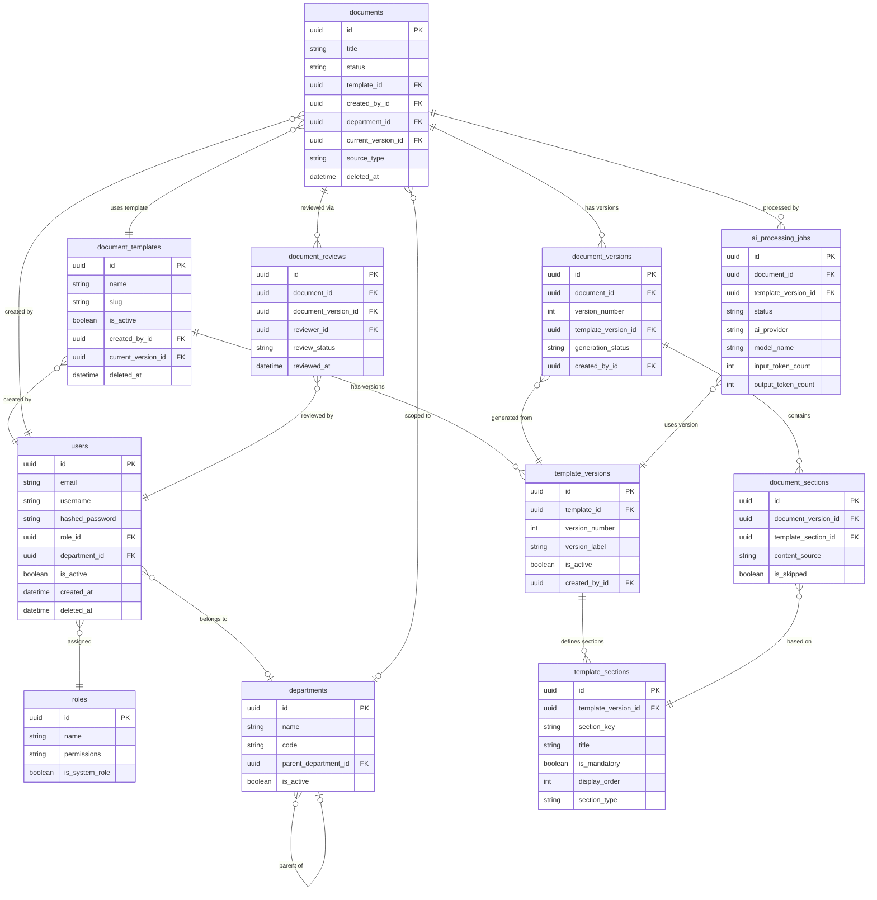

# DocuForge AI – Database Schema

---

## 1. Overview

DocuForge AI uses a **PostgreSQL** relational database managed via the **SQLAlchemy** ORM (declarative base pattern) with **Alembic** handling all schema migrations.

**Key design decisions:**

- **UUID primary keys** — All tables use `UUID` primary keys generated via PostgreSQL's `gen_random_uuid()` function. UUIDs avoid enumerable IDs in API responses, support distributed generation, and simplify data merges across environments.
- **`created_at` / `updated_at` timestamps** — Every table carries both columns (type: `TIMESTAMP WITH TIME ZONE`), defaulting to `now()` on insert and auto-updated via SQLAlchemy's `onupdate` hook or a PostgreSQL trigger.
- **Soft delete (`deleted_at`)** — Entities that must be retained for audit or FK integrity (e.g., `users`, `documents`, `document_templates`) use a nullable `deleted_at` timestamp instead of hard deletion. Application queries always filter `WHERE deleted_at IS NULL` unless explicitly fetching archived records.
- **JSONB for flexible storage** — Where data is semi-structured, schema-variable, or not queried relationally (AI outputs, event payloads, role permissions), PostgreSQL's `JSONB` column type is used. Columns that are filtered, joined, or sorted always use proper typed relational columns.
- **Enum-like status columns** — Status fields (e.g., `documents.status`) use `VARCHAR` with CHECK constraints or SQLAlchemy `Enum` types rather than a separate lookup table, keeping queries simple while still enforcing valid states at the DB level.
- **Alembic migrations** — All schema changes are version-controlled through Alembic migration scripts. No schema modification ever touches the database directly outside of a migration.

---

## 2. Database Entities

---

### 2.1 `users`

**Table Name:** `users`

**Purpose:** Stores all registered user accounts within the platform. Each user is associated with exactly one role (which governs their permissions) and optionally one department. Users are never hard-deleted; the `deleted_at` soft-delete column is used to deactivate accounts while preserving referential integrity with documents, reviews, and audit logs.

**Columns:**

| Column | Type | Constraints | Description |
|---|---|---|---|
| `id` | `UUID` | PK, default `gen_random_uuid()` | Primary key |
| `email` | `VARCHAR(255)` | UNIQUE, NOT NULL | User's email address; used as login identifier |
| `username` | `VARCHAR(100)` | UNIQUE, NOT NULL | URL-safe unique handle for the user |
| `hashed_password` | `VARCHAR(255)` | NOT NULL | Bcrypt hash of the user's password; plaintext is never stored |
| `full_name` | `VARCHAR(200)` | nullable | Display name used in UI and generated documents |
| `role_id` | `UUID` | FK → `roles.id`, NOT NULL | The user's assigned role; determines permission set |
| `department_id` | `UUID` | FK → `departments.id`, nullable | The department the user belongs to; optional |
| `is_active` | `BOOLEAN` | NOT NULL, default `true` | Whether the account is currently active; `false` blocks login |
| `is_verified` | `BOOLEAN` | NOT NULL, default `false` | Email verification flag; set to `true` after email confirmation |
| `last_login_at` | `TIMESTAMP WITH TIME ZONE` | nullable | Timestamp of the most recent successful login |
| `created_at` | `TIMESTAMP WITH TIME ZONE` | NOT NULL, default `now()` | Record creation timestamp |
| `updated_at` | `TIMESTAMP WITH TIME ZONE` | NOT NULL, default `now()` | Last modification timestamp |
| `deleted_at` | `TIMESTAMP WITH TIME ZONE` | nullable | Soft-delete timestamp; `NULL` means the user is active |

**Relationships:**
- `role_id` → `roles.id` (many-to-one)
- `department_id` → `departments.id` (many-to-one, optional)
- One user may own many `documents`, `document_templates`, `document_versions`, `document_reviews`, and `ai_usage_records`
- One user may have many `refresh_tokens`

**Indexes:**
- `idx_users_email` on `email`
- `idx_users_username` on `username`
- `idx_users_role_id` on `role_id`
- `idx_users_deleted_at` on `deleted_at` (partial index `WHERE deleted_at IS NULL` for active-user queries)

**Notes:**
Passwords must be hashed with `bcrypt` (minimum cost factor 12) before insertion. The application layer must never expose `hashed_password` via any API response. `is_active = false` takes precedence over all other flags — a deactivated user cannot log in regardless of token validity.

---

### 2.2 `roles`

**Table Name:** `roles`

**Purpose:** Defines the platform's role-based access control (RBAC) model. Each role carries a JSONB array of permission strings that the application resolves at request time. System roles (`is_system_role = true`) are seeded during the initial Alembic migration and must not be deleted. Custom roles may be created by `super_admin` users. This table is small and read-frequently; it may be cached in memory at application startup.

**Columns:**

| Column | Type | Constraints | Description |
|---|---|---|---|
| `id` | `UUID` | PK, default `gen_random_uuid()` | Primary key |
| `name` | `VARCHAR(50)` | UNIQUE, NOT NULL | Machine-readable role identifier (e.g., `super_admin`, `admin`, `manager`, `developer`) |
| `display_name` | `VARCHAR(100)` | nullable | Human-readable label shown in the UI |
| `description` | `TEXT` | nullable | Explanation of the role's intended purpose and scope |
| `permissions` | `JSONB` | NOT NULL, default `'[]'` | JSON array of permission strings (e.g., `["document:create", "template:manage"]`) |
| `is_system_role` | `BOOLEAN` | NOT NULL, default `true` | If `true`, the role is seeded and must not be deleted or renamed |
| `created_at` | `TIMESTAMP WITH TIME ZONE` | NOT NULL, default `now()` | Record creation timestamp |
| `updated_at` | `TIMESTAMP WITH TIME ZONE` | NOT NULL, default `now()` | Last modification timestamp |

**Relationships:**
- One role may be assigned to many `users`

**Indexes:**
- `idx_roles_name` on `name`
- GIN index `idx_roles_permissions_gin` on `permissions` (enables JSONB containment queries such as `permissions @> '["document:create"]'`)

**Notes:**
The initial Alembic migration seeds the four system roles: `super_admin`, `admin`, `manager`, `developer`. Application permission checks should evaluate the `permissions` JSONB array — never hardcode role name strings in business logic.

---

### 2.3 `departments`

**Table Name:** `departments`

**Purpose:** Represents organisational departments or teams within the enterprise. Departments form a self-referencing hierarchy via `parent_department_id`, supporting any number of nesting levels (e.g., Engineering → Backend → Platform). Documents and users may be associated with a department for scoping, reporting, and access filtering.

**Columns:**

| Column | Type | Constraints | Description |
|---|---|---|---|
| `id` | `UUID` | PK, default `gen_random_uuid()` | Primary key |
| `name` | `VARCHAR(200)` | UNIQUE, NOT NULL | Full department name (e.g., `Engineering`, `Product`) |
| `code` | `VARCHAR(50)` | UNIQUE, nullable | Short alphanumeric code for the department (e.g., `ENG`, `PROD`) |
| `description` | `TEXT` | nullable | Optional description of the department's function |
| `parent_department_id` | `UUID` | FK → `departments.id`, nullable | Self-referencing FK for hierarchical department trees |
| `is_active` | `BOOLEAN` | NOT NULL, default `true` | Whether the department is currently active |
| `created_at` | `TIMESTAMP WITH TIME ZONE` | NOT NULL, default `now()` | Record creation timestamp |
| `updated_at` | `TIMESTAMP WITH TIME ZONE` | NOT NULL, default `now()` | Last modification timestamp |

**Relationships:**
- `parent_department_id` → `departments.id` (self-referencing, many-to-one)
- One department may contain many `users` and many `documents`

**Indexes:**
- `idx_departments_parent_id` on `parent_department_id`
- `idx_departments_code` on `code`
- `idx_departments_is_active` on `is_active`

**Notes:**
Circular references in the hierarchy must be prevented at the application layer before insert/update. When deactivating a parent department, consider cascading `is_active = false` to all child departments.

---

### 2.4 `document_templates`

**Table Name:** `document_templates`

**Purpose:** Represents a named document template available on the platform (e.g., "Technical Design Document", "Project Charter", "Runbook"). A template is a logical container that tracks all its historical versions. The `current_version_id` FK points to the currently active `template_versions` record. Templates are soft-deleted rather than hard-deleted to preserve referential integrity with existing documents generated from them.

**Columns:**

| Column | Type | Constraints | Description |
|---|---|---|---|
| `id` | `UUID` | PK, default `gen_random_uuid()` | Primary key |
| `name` | `VARCHAR(200)` | NOT NULL | Display name of the template |
| `slug` | `VARCHAR(200)` | UNIQUE, NOT NULL | URL-safe unique identifier (e.g., `technical-design-document`) |
| `description` | `TEXT` | nullable | Overview of what this template is intended to produce |
| `is_active` | `BOOLEAN` | NOT NULL, default `true` | Whether the template is available for new document generation |
| `created_by_id` | `UUID` | FK → `users.id`, NOT NULL | The user who created this template definition |
| `current_version_id` | `UUID` | FK → `template_versions.id`, nullable | Points to the currently published/active version of this template |
| `created_at` | `TIMESTAMP WITH TIME ZONE` | NOT NULL, default `now()` | Record creation timestamp |
| `updated_at` | `TIMESTAMP WITH TIME ZONE` | NOT NULL, default `now()` | Last modification timestamp |
| `deleted_at` | `TIMESTAMP WITH TIME ZONE` | nullable | Soft-delete timestamp; `NULL` means the template is not deleted |

**Relationships:**
- `created_by_id` → `users.id` (many-to-one)
- `current_version_id` → `template_versions.id` (one-to-one, nullable)
- One template has many `template_versions`
- One template has many `documents`

**Indexes:**
- `idx_document_templates_slug` on `slug`
- `idx_document_templates_is_active` on `is_active`
- `idx_document_templates_created_by_id` on `created_by_id`
- `idx_document_templates_deleted_at` on `deleted_at`

**Notes:**
The `current_version_id` introduces a circular FK dependency between `document_templates` and `template_versions`. Manage this in SQLAlchemy with `use_alter=True` on the FK and `post_update=True` on the relationship to avoid constraint violation during inserts.

---

### 2.5 `template_versions`

**Table Name:** `template_versions`

**Purpose:** Tracks each versioned iteration of a document template. When a template's structure or DOCX file is updated, a new `template_version` record is created rather than overwriting the previous one. This guarantees that all documents generated from a specific version remain reproducible and auditable. Only one version per template should have `is_active = true` at any time.

**Columns:**

| Column | Type | Constraints | Description |
|---|---|---|---|
| `id` | `UUID` | PK, default `gen_random_uuid()` | Primary key |
| `template_id` | `UUID` | FK → `document_templates.id`, NOT NULL | The parent template this version belongs to |
| `version_number` | `INTEGER` | NOT NULL | Auto-incrementing version number scoped to `template_id` |
| `version_label` | `VARCHAR(50)` | nullable | Human-readable label (e.g., `v1.0`, `v2.1-beta`) |
| `change_notes` | `TEXT` | nullable | Description of what changed in this version |
| `template_file_path` | `VARCHAR(500)` | nullable | Storage path to the uploaded DOCX template file for this version |
| `is_active` | `BOOLEAN` | NOT NULL, default `false` | Whether this version is the currently active/published version |
| `published_at` | `TIMESTAMP WITH TIME ZONE` | nullable | Timestamp when this version was promoted to active |
| `created_by_id` | `UUID` | FK → `users.id`, NOT NULL | The user who created or published this version |
| `created_at` | `TIMESTAMP WITH TIME ZONE` | NOT NULL, default `now()` | Record creation timestamp |
| `updated_at` | `TIMESTAMP WITH TIME ZONE` | NOT NULL, default `now()` | Last modification timestamp |

**Constraints:**
- UNIQUE on `(template_id, version_number)`

**Relationships:**
- `template_id` → `document_templates.id` (many-to-one)
- `created_by_id` → `users.id` (many-to-one)
- One template version has many `template_sections`
- One template version is referenced by many `document_versions` and `ai_processing_jobs`

**Indexes:**
- `idx_template_versions_template_id` on `template_id`
- `idx_template_versions_is_active` on `(template_id, is_active)`

**Notes:**
Application logic must enforce that only one `template_version` per `template_id` has `is_active = true`. Use a database-level partial unique index or enforce via a transaction that sets the previous active version to `false` before activating the new one.

---

### 2.6 `template_sections`

**Table Name:** `template_sections`

**Purpose:** Defines the individual sections that make up a template version. Each section represents a logical unit of content in the generated document (e.g., "Objective", "Architecture Overview", "Risks"). Sections carry display metadata, ordering, and AI extraction hints. Business logic must always read section definitions from this table — section keys and titles are **never hardcoded** in application code.

**Columns:**

| Column | Type | Constraints | Description |
|---|---|---|---|
| `id` | `UUID` | PK, default `gen_random_uuid()` | Primary key |
| `template_version_id` | `UUID` | FK → `template_versions.id`, NOT NULL | The template version this section belongs to |
| `section_key` | `VARCHAR(100)` | NOT NULL | Machine-readable identifier (e.g., `objective`, `architecture_overview`) |
| `title` | `VARCHAR(300)` | NOT NULL | Display heading shown to users and rendered in generated documents |
| `description` | `TEXT` | nullable | Instructions for the AI and guidance for the user when filling this section |
| `is_mandatory` | `BOOLEAN` | NOT NULL, default `true` | If `true`, the section must have content or an explicit skip reason |
| `allow_skip` | `BOOLEAN` | NOT NULL, default `false` | If `true`, users are allowed to skip this section with a reason |
| `display_order` | `INTEGER` | NOT NULL | Ordering position within the template; sections are rendered in ascending order |
| `section_type` | `VARCHAR(50)` | NOT NULL | Structural type: `text`, `list`, `table`, `heading_only` |
| `ai_extraction_hint` | `TEXT` | nullable | Prompt fragment injected into the AI extraction prompt for this specific section |
| `created_at` | `TIMESTAMP WITH TIME ZONE` | NOT NULL, default `now()` | Record creation timestamp |
| `updated_at` | `TIMESTAMP WITH TIME ZONE` | NOT NULL, default `now()` | Last modification timestamp |

**Constraints:**
- UNIQUE on `(template_version_id, section_key)`

**Relationships:**
- `template_version_id` → `template_versions.id` (many-to-one)
- One template section is referenced by many `document_sections`

**Indexes:**
- `idx_template_sections_version_id` on `template_version_id`
- `idx_template_sections_display_order` on `(template_version_id, display_order)`

**Notes:**
The `section_key` is the stable machine-readable identity of a section across template version updates. When copying sections from one version to the next, preserve the `section_key` for existing sections and increment `version_number` on the parent `template_version`. The AI extraction pipeline uses `ai_extraction_hint` to construct targeted prompts per section.

---

### 2.7 `documents`

**Table Name:** `documents`

**Purpose:** The central entity of the platform. Each document record represents a user-submitted piece of content (uploaded file, pasted text, or manually entered) that is being standardised into a structured output using a document template. The `status` column drives the document's lifecycle through the processing pipeline. The `original_content` and `original_file_path` are immutable once set, preserving the source material for audit and reprocessing.

**Columns:**

| Column | Type | Constraints | Description |
|---|---|---|---|
| `id` | `UUID` | PK, default `gen_random_uuid()` | Primary key |
| `title` | `VARCHAR(500)` | NOT NULL | User-defined or auto-derived title for the document |
| `status` | `VARCHAR(50)` | NOT NULL, default `draft` | Lifecycle status: `draft`, `processing`, `review_pending`, `approved`, `rejected`, `generated`, `archived` |
| `template_id` | `UUID` | FK → `document_templates.id`, NOT NULL | The template this document is being generated against |
| `created_by_id` | `UUID` | FK → `users.id`, NOT NULL | The user who submitted this document |
| `department_id` | `UUID` | FK → `departments.id`, nullable | Optional department association for scoping and reporting |
| `current_version_id` | `UUID` | FK → `document_versions.id`, nullable | Points to the most recently generated document version |
| `source_type` | `VARCHAR(50)` | NOT NULL | How the original content was provided: `upload`, `paste`, `manual` |
| `original_content` | `TEXT` | nullable | Full original submitted content (for `paste` or `manual` source types) |
| `original_file_path` | `VARCHAR(500)` | nullable | Storage path to the original uploaded file (for `upload` source type) |
| `metadata` | `JSONB` | nullable | Flexible metadata bag: file size, MIME type, page count, tags, etc. |
| `created_at` | `TIMESTAMP WITH TIME ZONE` | NOT NULL, default `now()` | Record creation timestamp |
| `updated_at` | `TIMESTAMP WITH TIME ZONE` | NOT NULL, default `now()` | Last modification timestamp |
| `deleted_at` | `TIMESTAMP WITH TIME ZONE` | nullable | Soft-delete timestamp; `NULL` means the document is active |

**Relationships:**
- `template_id` → `document_templates.id` (many-to-one)
- `created_by_id` → `users.id` (many-to-one)
- `department_id` → `departments.id` (many-to-one, optional)
- `current_version_id` → `document_versions.id` (one-to-one, nullable)
- One document has many `document_versions`, `document_reviews`, `ai_processing_jobs`, and `processing_logs`

**Indexes:**
- `idx_documents_created_by_id` on `created_by_id`
- `idx_documents_status` on `status`
- `idx_documents_template_id` on `template_id`
- `idx_documents_deleted_at` on `deleted_at`
- `idx_documents_created_at` on `created_at`
- GIN index `idx_documents_metadata_gin` on `metadata` (for tag-based or property-based queries)

**Notes:**
Similar to `document_templates`, `current_version_id` creates a circular FK to `document_versions`. Use `use_alter=True` and `post_update=True` in SQLAlchemy. The `original_content` field should never be mutated after the document is created — it is the source-of-truth for reprocessing.

---

### 2.8 `document_versions`

**Table Name:** `document_versions`

**Purpose:** Each time the AI pipeline generates a structured output for a document (or a user triggers regeneration), a new `document_version` record is created. This provides a full history of all generated outputs, including which template version was used, allowing platform users to compare versions and roll back. The `template_version_id` is immutable once set, ensuring the relationship between a generated document and the exact template it was generated from is never lost.

**Columns:**

| Column | Type | Constraints | Description |
|---|---|---|---|
| `id` | `UUID` | PK, default `gen_random_uuid()` | Primary key |
| `document_id` | `UUID` | FK → `documents.id`, NOT NULL | The document this version belongs to |
| `version_number` | `INTEGER` | NOT NULL | Auto-incrementing version number scoped to `document_id` |
| `template_version_id` | `UUID` | FK → `template_versions.id`, NOT NULL | The exact template version used at generation time; immutable |
| `generated_file_path` | `VARCHAR(500)` | nullable | Storage path to the generated DOCX output file |
| `pdf_file_path` | `VARCHAR(500)` | nullable | Storage path to the generated PDF export |
| `markdown_content` | `TEXT` | nullable | Full Markdown rendering of the generated document content |
| `generation_status` | `VARCHAR(50)` | NOT NULL, default `pending` | Status of the generation job: `pending`, `generating`, `complete`, `failed` |
| `generation_notes` | `TEXT` | nullable | Human-readable notes about the generation outcome or failure reason |
| `created_by_id` | `UUID` | FK → `users.id`, NOT NULL | The user who initiated this generation |
| `created_at` | `TIMESTAMP WITH TIME ZONE` | NOT NULL, default `now()` | Record creation timestamp |

**Constraints:**
- UNIQUE on `(document_id, version_number)`

**Relationships:**
- `document_id` → `documents.id` (many-to-one)
- `template_version_id` → `template_versions.id` (many-to-one)
- `created_by_id` → `users.id` (many-to-one)
- One document version has many `document_sections`
- One document version may have many `document_reviews`

**Indexes:**
- `idx_document_versions_document_id` on `document_id`
- `idx_document_versions_template_version_id` on `template_version_id`
- `idx_document_versions_generation_status` on `generation_status`

**Notes:**
`template_version_id` must never be updated after a `document_version` row is created. If the template is updated and a document needs to be regenerated, a **new** `document_version` row is inserted pointing to the updated `template_version_id`. This is a core data integrity guarantee of the platform.

---

### 2.9 `document_sections`

**Table Name:** `document_sections`

**Purpose:** Stores the content for each individual section within a generated document version. Each row corresponds to one `template_section` within the template, populated with either AI-extracted content, user-provided content, or a combination. The `content_source` column tracks provenance. This table allows granular review, editing, and auditing of each section independently.

**Columns:**

| Column | Type | Constraints | Description |
|---|---|---|---|
| `id` | `UUID` | PK, default `gen_random_uuid()` | Primary key |
| `document_version_id` | `UUID` | FK → `document_versions.id`, NOT NULL | The document version this section belongs to |
| `template_section_id` | `UUID` | FK → `template_sections.id`, NOT NULL | The template section definition this content corresponds to |
| `content` | `TEXT` | nullable | The final approved content for this section (after any user edits) |
| `ai_extracted_content` | `TEXT` | nullable | Raw content extracted by the AI before any user confirmation or editing |
| `user_provided_content` | `TEXT` | nullable | Content manually entered by the user to fill a gap the AI could not extract |
| `is_skipped` | `BOOLEAN` | NOT NULL, default `false` | Whether the user explicitly skipped this section |
| `skip_reason` | `TEXT` | nullable | User-provided reason for skipping the section (required if `is_skipped = true`) |
| `content_source` | `VARCHAR(50)` | NOT NULL | Provenance of the final content: `ai_extracted`, `user_provided`, `ai_plus_user`, `skipped` |
| `created_at` | `TIMESTAMP WITH TIME ZONE` | NOT NULL, default `now()` | Record creation timestamp |
| `updated_at` | `TIMESTAMP WITH TIME ZONE` | NOT NULL, default `now()` | Last modification timestamp |

**Relationships:**
- `document_version_id` → `document_versions.id` (many-to-one)
- `template_section_id` → `template_sections.id` (many-to-one)

**Indexes:**
- `idx_document_sections_version_id` on `document_version_id`
- `idx_document_sections_template_section_id` on `template_section_id`

**Notes:**
When a document is first generated, one `document_section` row is inserted per `template_section` in the template version. If the user edits a section, `content` and `content_source` are updated in-place on the same row (not versioned separately at section level). If section-level history is needed in the future, a `document_section_history` table can be introduced via migration.

---

### 2.10 `document_reviews`

**Table Name:** `document_reviews`

**Purpose:** Tracks the review and approval workflow for documents. When a document is submitted for review, one or more `document_review` records are created assigning reviewers. Each reviewer records their decision and optional comments. The `review_status` field captures the outcome, which may trigger downstream status changes on the parent `document`.

**Columns:**

| Column | Type | Constraints | Description |
|---|---|---|---|
| `id` | `UUID` | PK, default `gen_random_uuid()` | Primary key |
| `document_id` | `UUID` | FK → `documents.id`, NOT NULL | The document under review |
| `document_version_id` | `UUID` | FK → `document_versions.id`, nullable | The specific version being reviewed (nullable for legacy compatibility) |
| `reviewer_id` | `UUID` | FK → `users.id`, NOT NULL | The user assigned as reviewer |
| `review_status` | `VARCHAR(50)` | NOT NULL, default `pending` | Outcome: `pending`, `approved`, `rejected`, `changes_requested` |
| `review_comments` | `TEXT` | nullable | Free-text comments from the reviewer |
| `reviewed_at` | `TIMESTAMP WITH TIME ZONE` | nullable | Timestamp when the reviewer submitted their decision |
| `created_at` | `TIMESTAMP WITH TIME ZONE` | NOT NULL, default `now()` | Record creation timestamp |
| `updated_at` | `TIMESTAMP WITH TIME ZONE` | NOT NULL, default `now()` | Last modification timestamp |

**Relationships:**
- `document_id` → `documents.id` (many-to-one)
- `document_version_id` → `document_versions.id` (many-to-one, optional)
- `reviewer_id` → `users.id` (many-to-one)

**Indexes:**
- `idx_document_reviews_document_id` on `document_id`
- `idx_document_reviews_reviewer_id` on `reviewer_id`
- `idx_document_reviews_review_status` on `review_status`

**Notes:**
If multiple reviewers are assigned, all must approve before the document transitions to `approved` status (unanimous approval), unless the platform is configured for majority-rule (a future configuration option). Review records are never deleted; they form part of the document's audit trail.

---

### 2.11 `ai_processing_jobs`

**Table Name:** `ai_processing_jobs`

**Purpose:** Records each invocation of the AI processing pipeline for a document. When a document is submitted for AI extraction, a job record is created and updated as the job progresses. The raw AI response and validated extraction output are stored as JSONB for auditability and debugging. Token counts and processing time support usage monitoring and cost estimation. Failed jobs preserve their `error_message` for operator investigation.

**Columns:**

| Column | Type | Constraints | Description |
|---|---|---|---|
| `id` | `UUID` | PK, default `gen_random_uuid()` | Primary key |
| `document_id` | `UUID` | FK → `documents.id`, NOT NULL | The document this job processed |
| `template_version_id` | `UUID` | FK → `template_versions.id`, NOT NULL | The template version used for extraction prompts in this job |
| `status` | `VARCHAR(50)` | NOT NULL, default `pending` | Job state: `pending`, `processing`, `completed`, `failed` |
| `ai_provider` | `VARCHAR(100)` | NOT NULL | AI provider used (e.g., `openai`, `anthropic`, `google`) |
| `model_name` | `VARCHAR(200)` | NOT NULL | Specific model identifier (e.g., `gpt-4o`, `claude-3-5-sonnet-20241022`) |
| `input_token_count` | `INTEGER` | nullable | Number of input tokens consumed |
| `output_token_count` | `INTEGER` | nullable | Number of output tokens generated |
| `processing_time_ms` | `INTEGER` | nullable | Total wall-clock time for the AI call in milliseconds |
| `error_message` | `TEXT` | nullable | Error description if the job failed |
| `raw_ai_response` | `JSONB` | nullable | Full structured response from the AI provider, stored verbatim for audit |
| `validated_extraction` | `JSONB` | nullable | Pydantic-validated and normalised extraction result, keyed by `section_key` |
| `started_at` | `TIMESTAMP WITH TIME ZONE` | nullable | Timestamp when processing began |
| `completed_at` | `TIMESTAMP WITH TIME ZONE` | nullable | Timestamp when processing finished (success or failure) |
| `created_at` | `TIMESTAMP WITH TIME ZONE` | NOT NULL, default `now()` | Record creation timestamp |

**Relationships:**
- `document_id` → `documents.id` (many-to-one)
- `template_version_id` → `template_versions.id` (many-to-one)
- One AI processing job may produce one `ai_usage_record`

**Indexes:**
- `idx_ai_jobs_document_id` on `document_id`
- `idx_ai_jobs_status` on `status`
- `idx_ai_jobs_created_at` on `created_at`
- GIN index `idx_ai_jobs_validated_extraction_gin` on `validated_extraction`

**Notes:**
`raw_ai_response` stores the unmodified API response from the AI provider. `validated_extraction` stores the result after Pydantic schema validation and normalisation. Storing both allows debugging of extraction failures without re-calling the AI. These columns must never be exposed verbatim in public API responses due to potential sensitive content in the source document.

---

### 2.12 `ai_usage_records`

**Table Name:** `ai_usage_records`

**Purpose:** Provides a detailed, immutable log of AI token consumption and estimated cost for every AI processing job. This table supports usage dashboards, billing reports, per-user quota enforcement, and cost attribution by department or document. One record is inserted per completed `ai_processing_job`; records are never updated or deleted.

**Columns:**

| Column | Type | Constraints | Description |
|---|---|---|---|
| `id` | `UUID` | PK, default `gen_random_uuid()` | Primary key |
| `user_id` | `UUID` | FK → `users.id`, NOT NULL | The user who triggered the AI processing job |
| `ai_processing_job_id` | `UUID` | FK → `ai_processing_jobs.id`, NOT NULL | The job this usage record corresponds to |
| `ai_provider` | `VARCHAR(100)` | NOT NULL | AI provider name (denormalised from the job for simpler reporting queries) |
| `model_name` | `VARCHAR(200)` | NOT NULL | Model identifier (denormalised from the job) |
| `input_tokens` | `INTEGER` | NOT NULL | Number of input tokens consumed |
| `output_tokens` | `INTEGER` | NOT NULL | Number of output tokens generated |
| `estimated_cost_usd` | `NUMERIC(10, 6)` | nullable | Estimated cost in USD based on the provider's pricing at record time |
| `recorded_at` | `TIMESTAMP WITH TIME ZONE` | NOT NULL, default `now()` | Timestamp when this usage was recorded |

**Relationships:**
- `user_id` → `users.id` (many-to-one)
- `ai_processing_job_id` → `ai_processing_jobs.id` (one-to-one)

**Indexes:**
- `idx_ai_usage_user_id` on `user_id`
- `idx_ai_usage_recorded_at` on `recorded_at`
- `idx_ai_usage_job_id` on `ai_processing_job_id`

**Notes:**
Denormalising `ai_provider` and `model_name` onto this table (from the job) intentionally simplifies aggregate reporting queries — avoiding joins when producing usage summaries. `estimated_cost_usd` is computed at record time using the pricing schedule known to the application; actual billed costs may differ and should be reconciled against provider invoices.

---

### 2.13 `processing_logs`

**Table Name:** `processing_logs`

**Purpose:** An append-only audit log that records all significant events across the platform lifecycle — document creation, AI job status changes, file exports, user authentication events, errors, and warnings. This table provides a tamper-evident event trail for compliance, debugging, and security investigations. Records are **never updated or deleted**. Sensitive data (passwords, tokens, raw AI content) must never appear in `event_data`.

**Columns:**

| Column | Type | Constraints | Description |
|---|---|---|---|
| `id` | `UUID` | PK, default `gen_random_uuid()` | Primary key |
| `document_id` | `UUID` | FK → `documents.id`, nullable | The document this event relates to, if applicable |
| `user_id` | `UUID` | FK → `users.id`, nullable | The user who triggered the event, if applicable |
| `event_type` | `VARCHAR(100)` | NOT NULL | Dot-namespaced event identifier (e.g., `document.created`, `ai.processing.started`, `export.pdf`, `auth.login.failed`) |
| `event_data` | `JSONB` | nullable | Structured contextual data for the event; must not contain sensitive content |
| `ip_address` | `VARCHAR(45)` | nullable | Client IP address (supports IPv4 and IPv6) |
| `user_agent` | `TEXT` | nullable | HTTP User-Agent string from the request |
| `severity` | `VARCHAR(20)` | NOT NULL, default `info` | Log level: `info`, `warning`, `error` |
| `created_at` | `TIMESTAMP WITH TIME ZONE` | NOT NULL, default `now()` | Immutable event timestamp |

**Relationships:**
- `document_id` → `documents.id` (many-to-one, optional)
- `user_id` → `users.id` (many-to-one, optional)

**Indexes:**
- `idx_processing_logs_document_id` on `document_id`
- `idx_processing_logs_user_id` on `user_id`
- `idx_processing_logs_event_type` on `event_type`
- `idx_processing_logs_created_at` on `created_at`
- `idx_processing_logs_severity` on `severity`
- GIN index `idx_processing_logs_event_data_gin` on `event_data`

**Notes:**
This table should be treated as write-only from the application perspective. No `UPDATE` or `DELETE` statements should ever target it. For high-volume deployments, consider partitioning this table by `created_at` (monthly or quarterly) to maintain query performance as the log grows. For compliance requirements (e.g., GDPR right-to-erasure), ensure `user_id` can be nullified without other PII remaining in `event_data`.

---

### 2.14 `refresh_tokens`

**Table Name:** `refresh_tokens`

**Purpose:** Stores hashed refresh tokens issued during user authentication. Refresh tokens allow users to obtain new access tokens without re-authenticating. Only the hash of the token is stored — the plaintext is sent to the client once and never retained server-side. Tokens can be explicitly revoked (e.g., on logout or password change), and all tokens for a user can be revoked in bulk for security events.

**Columns:**

| Column | Type | Constraints | Description |
|---|---|---|---|
| `id` | `UUID` | PK, default `gen_random_uuid()` | Primary key |
| `user_id` | `UUID` | FK → `users.id`, NOT NULL | The user this token was issued for |
| `token_hash` | `VARCHAR(255)` | UNIQUE, NOT NULL | SHA-256 or bcrypt hash of the refresh token; plaintext is never stored |
| `expires_at` | `TIMESTAMP WITH TIME ZONE` | NOT NULL | Absolute expiry timestamp for this token |
| `is_revoked` | `BOOLEAN` | NOT NULL, default `false` | Whether this token has been explicitly revoked |
| `revoked_at` | `TIMESTAMP WITH TIME ZONE` | nullable | Timestamp when the token was revoked |
| `created_at` | `TIMESTAMP WITH TIME ZONE` | NOT NULL, default `now()` | Record creation timestamp |

**Relationships:**
- `user_id` → `users.id` (many-to-one)

**Indexes:**
- `idx_refresh_tokens_user_id_is_revoked` on `(user_id, is_revoked)` — optimises lookup of active tokens for a user
- `idx_refresh_tokens_expires_at` on `expires_at` — supports efficient cleanup of expired tokens
- `idx_refresh_tokens_token_hash` on `token_hash` (the UNIQUE constraint implicitly creates this)

**Notes:**
A background maintenance job should periodically hard-delete rows where `expires_at < now()` or `is_revoked = true` to prevent unbounded table growth. On user logout, set `is_revoked = true` and `revoked_at = now()` for the specific token. On a security event (password reset, account compromise), bulk-revoke all tokens for the user.

---

## 3. JSONB Usage Explanation

PostgreSQL's `JSONB` type provides efficient binary-encoded storage for semi-structured data, with support for GIN indexing and powerful operators. DocuForge AI uses JSONB selectively — only where the data is genuinely variable in schema, not commonly filtered or joined, and where the overhead of maintaining a separate table outweighs the benefit.

### Where JSONB Is Used and Why

| Table | Column | Rationale |
|---|---|---|
| `roles` | `permissions` | The permission set for a role is an array of string identifiers. The specific permissions granted to each role evolve over time without requiring schema changes. The containment operator `@>` is used to check whether a role has a specific permission. |
| `documents` | `metadata` | Flexible document metadata varies by source type and integration: file size, MIME type, page count, language detection result, custom tags, external system IDs. Schema normalisation would require frequent migrations for every new metadata field. |
| `ai_processing_jobs` | `raw_ai_response` | The full response from an AI provider is stored verbatim. Provider response shapes differ between OpenAI, Anthropic, and Google, and may change over time. Storing the raw response enables debugging without re-calling the API. |
| `ai_processing_jobs` | `validated_extraction` | The Pydantic-validated extraction result, keyed by `section_key`, is stored as JSONB. This output is semi-structured (each section's content is different) and is consumed by the document generation pipeline. |
| `processing_logs` | `event_data` | Each event type carries different contextual data. Normalising every event type into typed columns would require an extremely wide table or many event-type-specific tables. JSONB provides schema flexibility while GIN indexing supports targeted queries. |

### Where Relational Columns Are Used Instead

Any data that is **filtered**, **sorted**, **joined**, **aggregated**, or **used in a WHERE clause** lives in typed relational columns rather than inside a JSONB blob:

- `documents.status` — filtered in every document list query
- `ai_processing_jobs.status` — polled by the processing pipeline and dashboards
- `ai_usage_records.input_tokens`, `output_tokens`, `estimated_cost_usd` — aggregated for usage reports
- `processing_logs.event_type`, `severity`, `created_at` — filtered in audit queries
- All UUID foreign keys — joined across tables
- All timestamp columns — sorted and range-filtered

### When NOT to Use JSONB

> [!WARNING]
> Do **not** use JSONB for data that:
> - Needs to be filtered with `WHERE`, sorted with `ORDER BY`, or joined with `JOIN`
> - Requires referential integrity or FK constraints
> - Is better represented as an enum (use `VARCHAR` with CHECK constraints or SQLAlchemy `Enum`)
> - Has a stable, well-known schema (use typed columns)
> - Is numeric and subject to arithmetic operations (use `INTEGER`, `NUMERIC`, or `FLOAT`)

### JSONB Query Operators and Indexing

```sql
-- Containment: check if a role has a specific permission
SELECT * FROM roles WHERE permissions @> '["document:create"]';

-- Key existence: check if metadata has a specific key
SELECT * FROM documents WHERE metadata ? 'tags';

-- Path access: extract a nested value
SELECT metadata ->> 'mime_type' FROM documents;

-- GIN index to accelerate containment and existence queries
CREATE INDEX idx_roles_permissions_gin ON roles USING GIN (permissions);
CREATE INDEX idx_documents_metadata_gin ON documents USING GIN (metadata);
CREATE INDEX idx_processing_logs_event_data_gin ON processing_logs USING GIN (event_data);
CREATE INDEX idx_ai_jobs_validated_extraction_gin ON ai_processing_jobs USING GIN (validated_extraction);
```

---

## 4. Indexing Strategy

Beyond primary key indexes (created automatically on all `id` columns) and unique constraint indexes, the following indexes are defined to support the platform's most common query patterns:

### `users`
| Index Name | Columns | Type | Purpose |
|---|---|---|---|
| `idx_users_email` | `email` | B-Tree | Login lookup by email |
| `idx_users_username` | `username` | B-Tree | Username lookup and uniqueness check |
| `idx_users_role_id` | `role_id` | B-Tree | Filter users by role |
| `idx_users_deleted_at` | `deleted_at` WHERE `deleted_at IS NULL` | Partial B-Tree | Efficient active-user queries |

### `documents`
| Index Name | Columns | Type | Purpose |
|---|---|---|---|
| `idx_documents_created_by_id` | `created_by_id` | B-Tree | List documents by owner |
| `idx_documents_status` | `status` | B-Tree | Filter by pipeline status |
| `idx_documents_template_id` | `template_id` | B-Tree | Filter by template |
| `idx_documents_deleted_at` | `deleted_at` WHERE `deleted_at IS NULL` | Partial B-Tree | Exclude soft-deleted documents |
| `idx_documents_created_at` | `created_at` | B-Tree | Sort and range queries on creation date |
| `idx_documents_metadata_gin` | `metadata` | GIN | JSONB containment and key-existence queries |

### `document_versions`
| Index Name | Columns | Type | Purpose |
|---|---|---|---|
| `idx_document_versions_document_id` | `document_id` | B-Tree | Fetch all versions of a document |
| `idx_document_versions_template_version_id` | `template_version_id` | B-Tree | Find all documents generated from a specific template version |
| `idx_document_versions_generation_status` | `generation_status` | B-Tree | Poll for in-progress generation jobs |

### `document_sections`
| Index Name | Columns | Type | Purpose |
|---|---|---|---|
| `idx_document_sections_version_id` | `document_version_id` | B-Tree | Fetch all sections for a document version |
| `idx_document_sections_template_section_id` | `template_section_id` | B-Tree | Cross-reference with template section definitions |

### `ai_processing_jobs`
| Index Name | Columns | Type | Purpose |
|---|---|---|---|
| `idx_ai_jobs_document_id` | `document_id` | B-Tree | Find all jobs for a document |
| `idx_ai_jobs_status` | `status` | B-Tree | Poll for pending or processing jobs |
| `idx_ai_jobs_created_at` | `created_at` | B-Tree | Time-range queries for job history |
| `idx_ai_jobs_validated_extraction_gin` | `validated_extraction` | GIN | JSONB queries on extraction output |

### `ai_usage_records`
| Index Name | Columns | Type | Purpose |
|---|---|---|---|
| `idx_ai_usage_user_id` | `user_id` | B-Tree | Per-user usage aggregation |
| `idx_ai_usage_recorded_at` | `recorded_at` | B-Tree | Time-range usage reports |
| `idx_ai_usage_job_id` | `ai_processing_job_id` | B-Tree | Join from job to usage record |

### `processing_logs`
| Index Name | Columns | Type | Purpose |
|---|---|---|---|
| `idx_processing_logs_document_id` | `document_id` | B-Tree | Audit trail for a specific document |
| `idx_processing_logs_user_id` | `user_id` | B-Tree | Audit trail for a specific user |
| `idx_processing_logs_event_type` | `event_type` | B-Tree | Filter by event category |
| `idx_processing_logs_created_at` | `created_at` | B-Tree | Time-range audit queries |
| `idx_processing_logs_severity` | `severity` | B-Tree | Filter by log level (e.g., errors only) |
| `idx_processing_logs_event_data_gin` | `event_data` | GIN | JSONB queries on event payload |

### `refresh_tokens`
| Index Name | Columns | Type | Purpose |
|---|---|---|---|
| `idx_refresh_tokens_user_id_is_revoked` | `(user_id, is_revoked)` | B-Tree (composite) | Find active (non-revoked) tokens for a user |
| `idx_refresh_tokens_expires_at` | `expires_at` | B-Tree | Efficient cleanup of expired tokens |

### `template_sections`
| Index Name | Columns | Type | Purpose |
|---|---|---|---|
| `idx_template_sections_version_id` | `template_version_id` | B-Tree | Fetch all sections for a template version |
| `idx_template_sections_display_order` | `(template_version_id, display_order)` | B-Tree (composite) | Ordered section retrieval |

### `template_versions`
| Index Name | Columns | Type | Purpose |
|---|---|---|---|
| `idx_template_versions_template_id` | `template_id` | B-Tree | Fetch all versions of a template |
| `idx_template_versions_is_active` | `(template_id, is_active)` | B-Tree (composite) | Find the active version for a template |

---

## 5. ER Diagram

The diagram below covers the core entities and their most significant relationships. Less central tables (`ai_usage_records`, `processing_logs`, `refresh_tokens`) are omitted for clarity.



---

## 6. Migration Strategy

DocuForge AI uses **Alembic** for all database schema management. No manual DDL is ever executed directly against any environment's database.

### Workflow

1. **Define or modify SQLAlchemy models** in `app/models/`.
2. **Autogenerate a migration** by running:
   ```bash
   alembic revision --autogenerate -m "describe_your_change"
   ```
3. **Review the generated migration script** in `alembic/versions/`. Autogenerate is a starting point — always inspect the output for correctness, especially for:
   - Renamed columns (autogenerate may emit a drop + add instead of a rename)
   - JSONB columns and GIN indexes (may require manual specification)
   - Circular FK relationships that require `use_alter=True`
   - Partial indexes (must be written manually using SQLAlchemy's `postgresql_where` argument)
4. **Apply to the target environment:**
   ```bash
   alembic upgrade head
   ```
5. **Rollback if needed:**
   ```bash
   alembic downgrade -1
   ```

### Immutability of Existing Migrations

> [!IMPORTANT]
> **Never modify an existing migration file once it has been applied to any shared environment** (development, staging, or production). Alembic uses the migration chain's checksums and version identifiers to track state. Modifying an applied migration will break the chain and cause `alembic upgrade head` to fail or produce incorrect results. If a previously applied migration contains an error, write a **new** migration to correct it.

### Deployment

```bash
# Applied automatically on container startup or via CI/CD pipeline
alembic upgrade head
```

Migrations are applied as part of the application deployment pipeline before the FastAPI application boots. If a migration fails, the deployment is rolled back and the database remains at its previous version.

### Seed Data

**System roles** (the four built-in roles: `super_admin`, `admin`, `manager`, `developer`) are seeded inside the **initial Alembic migration** (`0001_initial_schema.py`) using `op.bulk_insert()`. This guarantees that the roles table is populated immediately after the schema is created in any environment.

```python
# Example seed within migration
def upgrade():
    # ... table creation DDL ...
    op.bulk_insert(
        roles_table,
        [
            {"id": "...", "name": "super_admin", "display_name": "Super Admin", "is_system_role": True, "permissions": ["*"]},
            {"id": "...", "name": "admin", "display_name": "Administrator", "is_system_role": True, "permissions": ["document:*", "template:*", "user:manage"]},
            {"id": "...", "name": "manager", "display_name": "Manager", "is_system_role": True, "permissions": ["document:create", "document:review", "document:approve"]},
            {"id": "...", "name": "developer", "display_name": "Developer", "is_system_role": True, "permissions": ["document:create", "document:view"]},
        ]
    )
```

**Environment-specific seed data** (demo documents, test users, sample templates) is managed via separate Python seeder scripts in `scripts/seeds/`, invoked manually or as part of environment provisioning:

```bash
python scripts/seeds/seed_dev.py        # Development seed data
python scripts/seeds/seed_staging.py    # Staging demo data
```

Seeder scripts must be **idempotent** — they check for existing records before inserting to prevent duplicate data on repeated runs.

> [!NOTE]
> Never include sensitive credentials, production user data, or customer documents in seeder scripts committed to version control. Use environment variables or a secrets manager for any credentials required by seeders.
